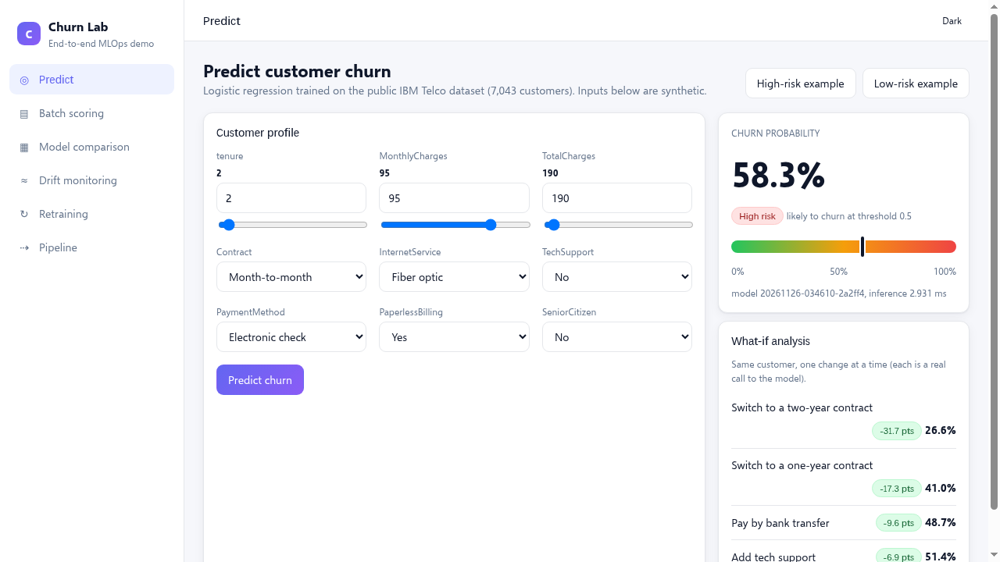
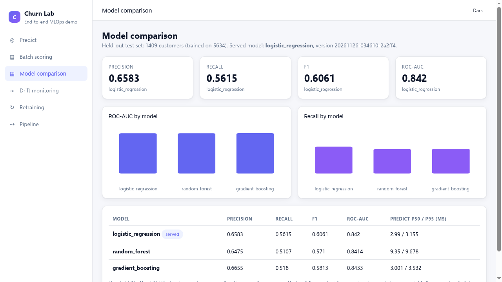
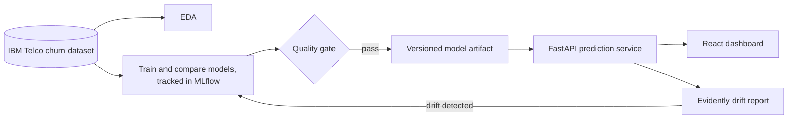

# Customer Churn: MLOps pipeline

End-to-end churn pipeline on the public IBM Telco Customer Churn dataset (7,043 customers): EDA, experiment tracking with MLflow, model comparison, versioned model artifacts, a FastAPI prediction service, Evidently drift monitoring, and drift-triggered retraining.

**Live demo (free tier):** https://churn-web-ochre.vercel.app  (Predict, Model & metrics, Drift monitoring tabs)
API docs: https://churn-api-iota.vercel.app/docs




Pages: Predict (what-if analysis, each variant is a real API call), Batch scoring (CSV paste), Model comparison, Drift monitoring, Retraining, Pipeline.

## System overview


**Tech stack:** scikit-learn, MLflow, Evidently, FastAPI, React, TypeScript, Pytest, Docker.

## Pipeline
```
data/telco_churn.csv -> eda.py (eda/eda_report.md, eda.png)
  -> churn/train.py   3 models, MLflow runs (params, metrics, latency) -> models/<version>/{model.joblib, model.json, metadata.json}
  -> churn/serve.py   FastAPI: /predict /model /stats /health  (numpy-only inference from model.json)
  -> churn/drift.py   Evidently DataDriftPreset: reference = train, current = new batch -> reports/*.html, summary.json
  -> churn/retrain.py if drifted columns > 20%: retrain on train + new batch, compare old vs new, keep as candidate (promote with PROMOTE=1)
```

## Results (real run, held-out 20% = 1,409 customers, threshold 0.5)
| Model | Precision | Recall | F1 | ROC-AUC |
|---|---|---|---|---|
| Logistic regression (served) | 0.658 | 0.562 | 0.606 | 0.842 |
| Random forest | 0.648 | 0.511 | 0.571 | 0.841 |
| Gradient boosting | 0.666 | 0.516 | 0.581 | 0.843 |

- Latency: in-process numpy inference measured by the API at about 0.2 to 3 ms per call (live: `inference_ms` field). A full HTTPS request to the deployed function took roughly 0.15 to 0.29 s from this sandbox, dominated by network and serverless overhead. sklearn single-row predict p50/p95 for each model is in the Model tab (3 to 9 ms).
- The three models are within about 0.002 ROC-AUC of each other. That difference is not meaningful with one split and no confidence intervals. I serve logistic regression because it is as good here, interpretable, and exports to plain numpy.
- Recall of 0.56 means about 44% of churners are missed at threshold 0.5. A lower threshold would trade precision for recall; I did not tune it.
- Drift (Evidently): holdout vs training 0/19 columns drifted. **Simulated** shift (prices +30%, shorter tenure, more month-to-month contracts) 4/19 (21.1%) drifted, which crosses my 20% retrain threshold (my own choice; Evidently's default share is 0.5).
- Retrain demo (`reports/retrain.json`): on simulated drift the retrained logistic regression scores ROC-AUC 0.8473 vs 0.8469 for the old one (F1 0.606 vs 0.598) on a later shifted batch, a negligible difference. **The simulated rows reuse the original labels, so this demonstrates the retraining mechanism, not a real-world gain.**

## Honest status
- Dataset is public (IBM sample, Apache-2.0), not private data. All drift beyond the clean holdout check is **simulated**; there is no real production traffic.
- The live API serves logistic regression via exported numpy weights, because scikit-learn/pandas/MLflow/Evidently do not fit a free serverless function. A test checks the numpy model equals the sklearn pipeline on every test row (max difference below 1e-9).
- MLflow runs are recorded locally in `mlflow.db` (SQLite, not committed). There is no hosted MLflow server. There is no model registry beyond versioned folders.
- Evidently reports are static HTML generated offline and shipped with the frontend.
- Docker and GitHub Actions files are written but not verified (no Docker here; the push token had no workflow scope, so CI lives in `.github/workflows/`).
- Counts: 9 backend tests (real data, no mocks) and 2 frontend tests pass.

## Run
```bash
pip install -r requirements-train.txt
python eda.py && python -m churn.train && python -m churn.drift && python -m churn.retrain
pytest
uvicorn churn.serve:app                         # API
./scripts_sync_public.sh && cd frontend && npm i && npm run build   # UI (set VITE_API_URL)
docker compose up --build                       # unverified
```

## 5 things to understand to explain this project
1. **Imbalanced target**: 26.5% churn, so accuracy is misleading; I report precision, recall, F1 and ROC-AUC.
2. **Experiment tracking**: every model run logs params, metrics and latency to MLflow; the served model is a versioned folder with metadata, so you can say which model produced a prediction.
3. **Train/serve parity**: the served numpy model is tested against the trained sklearn pipeline on the whole test set.
4. **Drift monitoring**: Evidently compares new data to the training reference per column; a share of drifted columns above a threshold triggers retraining. Drift is about inputs, not proof the model got worse.
5. **Retraining is a candidate, not an auto-deploy**: the new model is saved but only served after explicit promotion. The numbers here show how little a retrain helps on simulated drift, and I say so.

## Accounts and saved predictions
`POST /auth/register`, `POST /auth/login`, `GET /auth/me` (PBKDF2-SHA256 + JWT). Predictions made while logged in are saved to the `churn_predictions` table (PostgreSQL via `DATABASE_URL`, SQLite fallback for local runs) and listed in the UI under "My saved predictions" (`GET /history`, `DELETE /history`). Guests can still predict; nothing is stored for them. Tests: `tests/test_accounts.py`, `frontend/src/auth.test.tsx`. Not built: email verification, password reset, rate limiting.
